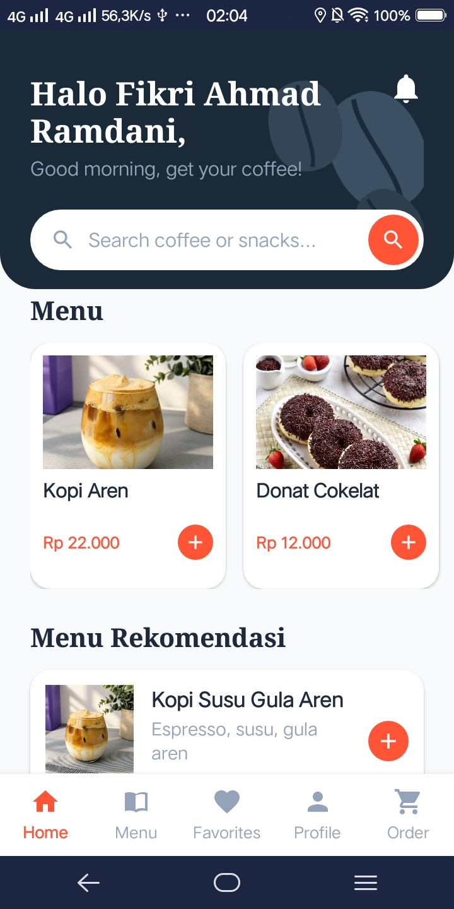
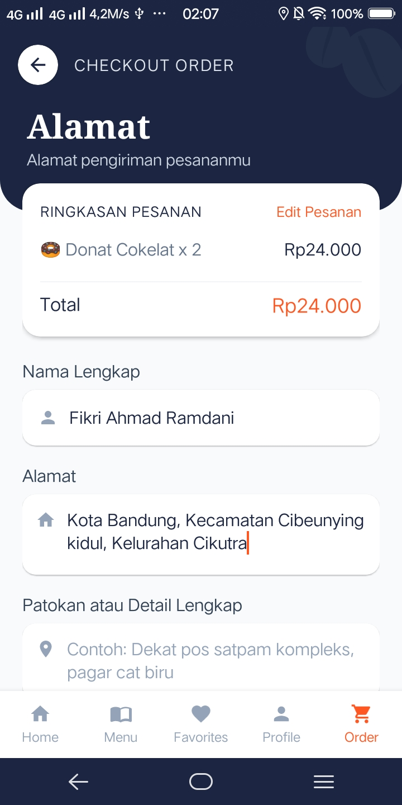
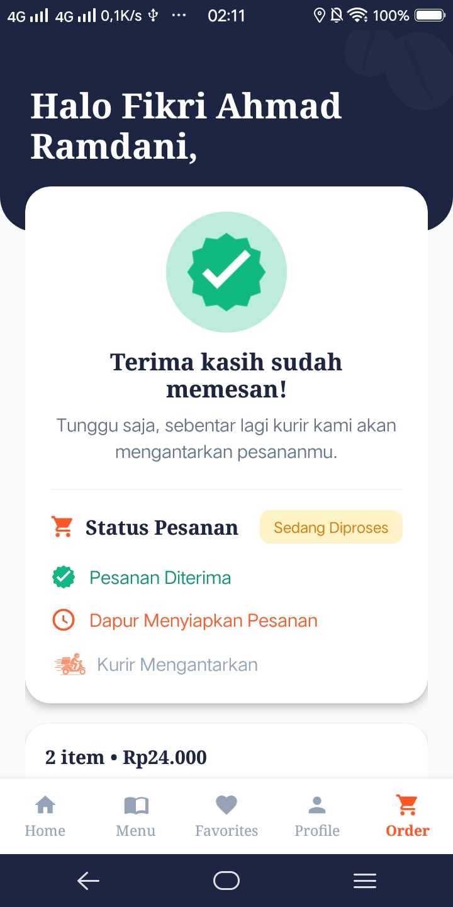

# ☕ Kopi dan Nyemil

Aplikasi mobile pemesanan kopi dan camilan berbasis Android (Kotlin + Jetpack Compose) dengan tema biru muda dan putih. Dibuat untuk Memenuhi UTS mata kuliah Pengembangan Aplikasi Mobile.

**Tagline:** Get a taste of your wish

---

## 📱 Deskripsi

Pengguna dapat mendaftar atau login, melihat daftar makanan dan minuman, menambahkan pesanan ke keranjang, mengisi alamat pengiriman, lalu menerima konfirmasi pesanan. Seluruh data bersifat statis (dummy) dan disimpan di memori, tanpa database.

---

## ✨ Fitur

* **Splash / Welcome** dengan animasi logo
* **Sign Up** (pilihan Register atau Login)
* **Login** dengan validasi (akun demo tersedia)
* **Register** dengan validasi (nama, username unik, password minimal 6 karakter)
* **Home**: sapaan nama pengguna, filter kategori (Semua / Minuman / Makanan), 7 menu dengan foto, tombol tambah/kurang jumlah, dan bar ringkasan keranjang
* **Profile**: lihat dan ubah nama, simpan, logout
* **Alamat Pengiriman (Order)**: ringkasan pesanan dan total, form nama, alamat, dan patokan
* **Konfirmasi Pesanan**: animasi centang dan ringkasan order
* **Bottom Navigation** (Home / Order / Profile) dengan badge jumlah item

---

## 🛠️ Teknologi

* **Kotlin 2.2**
* **Jetpack Compose** dan **Material 3**
* **Navigation Compose**
* **ViewModel** (state in-memory)
* **Coil** (memuat gambar menu)
* **Android Gradle Plugin 8.5**, `minSdk 24`, `targetSdk 34`

---

## 🚀 Cara Menjalankan

1. Install Android Studio (versi terbaru) dan JDK 17.
2. Buka folder project **KopiDanNyemil** lewat **File → Open**, lalu tunggu *Gradle Sync* selesai.
3. Pilih emulator atau HP Android (Android 7.0 / API 24 ke atas).
4. Klik tombol **Run ▶**.
5. **Akun demo:** username `demo` dan password `demo123`, atau buat akun baru lewat Register.

---

## 🔄 Alur Aplikasi

* Splash ➔ Sign Up ➔ Login / Register ➔ Home ➔ (Order) Alamat ➔ Konfirmasi ➔ Home
* Home ⇄ Profile melalui bottom navigation.

---

### Splash, Sign Up, Login, dan Register
| Splash | Sign Up | Login | Register |
| :---: | :---: | :---: | :---: |
|  |  |  |  |

### Home, Profile, Alamat, dan Konfirmasi
| Home | Profile | Alamat | Konfirmasi |
| :---: | :---: | :---: | :---: |
|  |  |  |  |

---

## 📁 Struktur Project

```text
KopiDanNyemil/
├── app/
│   └── src/
│       └── main/
│           └── java/
│               └── com/kopidannyemil/app/
│                   ├── MainActivity.kt        # NavHost dan routing
│                   ├── AppViewModel.kt        # state: user, keranjang, order
│                   ├── data/Models.kt         # model dan dummy data
│                   └── ui/
│                       ├── theme/Theme.kt     # palet biru muda dan putih
│                       ├── components/        # TextField, Button, BottomBar, dll.
│                       └── screens/           # 8 layar sesuai wireframe
├── screenshots/                               # Kumpulan gambar screenshot
└── README.md

👤 Author
Nama: Fikri Ahmad Ramdani
NIM: 1247050003
